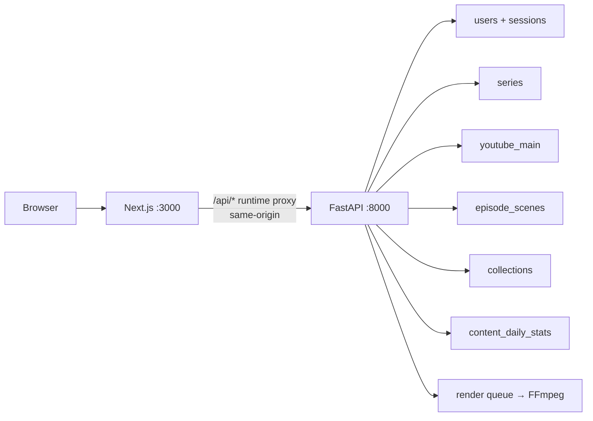
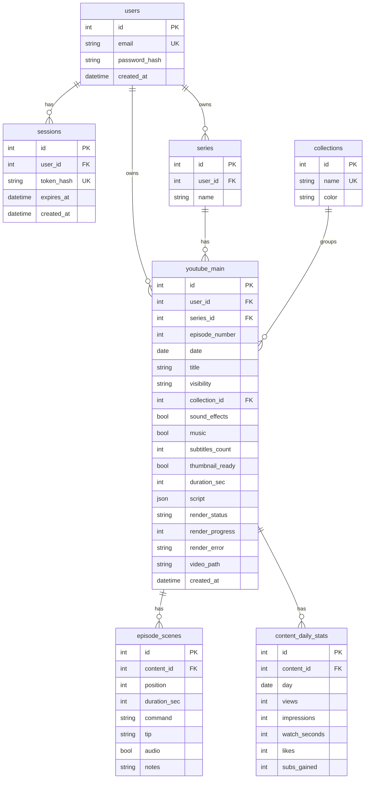

# Auth, dashboard, Lab, emulator, Library

The app today is a single unauthenticated page: dense KPIs/charts + a master table + `AddEpisodeDialog` that creates one flat `command/tip` script. There are **no users, no scenes, no dedicated routes**. This plan turns it into an authenticated studio with five surfaces built directly from the workbook.

**Workbook source of truth:** [`youTube-master-content-managment-v001.xlsx`](../../youTube-master-content-managment-v001.xlsx) (and its preview [`youTube-master-content-managment-v001.png`](../../youTube-master-content-managment-v001.png)) at the repo root. Export path referenced in the draft plan (`/home/unique/.../attachments/...csv`) is stale — use the repo-relative workbook instead. The workbook is the spec; the DB is a normalized projection of it.



## Workbook inventory (9 sheets)

| Sheet | Tab color | Purpose in product | Maps to |
|---|---|---|---|
| **YouTube Main 📌** | red | Denormalized episode log — the primary Library table. Each row is one Short; cells are **formulas** (XLOOKUP/COUNTIF) over the other sheets, not manual text. | `youtube_main` |
| **Contents 🖊️** | — | Authoring source for scenario lookup: `Senario Lookup`, `Title`, `Shared Link`, `Language`, `SCN Count`, `DEMO`, `Description`, `Tags` | `youtube_main.title` + scene templates |
| **Episodes ⏭️** | — | Episode → Collection registry. `Episode number` + derived `Scense Title` | `series` + `youtube_main.collection_id` |
| **Scenses 🎬** | purple | Scene breakdown per content: `SCN`, `SCN Number`, `Scense Title`, `SCN Hook`, `SCN Senario`, `SCN Body` | `episode_scenes` |
| **Languages 🌍** | — | Available subtitle/dub languages | `languages` enum / future table; today `subtitles_count` + string |
| **Assets👁️👁️** | — | Visual/auditory asset checklist (effects, sounds) | `sound_effects`, `music`, `effects` |
| **Subtitles 🔍** | — | One row per episode that has subtitles → count per episode drives `Subtitles` column (`COUNTIF('Subtitles 🔍'!A:A, Episode)`) | `youtube_main.subtitles_count` |
| **Collections 📃** | green-gray | Channel collections with metadata (name, description, playlist hyperlink) | `collections` |
| **Body Content** | hidden | Template rows / hidden helpers | — (ignore) |

> Only after inspecting the real `.xlsx` did the extra tabs surface — the first draft of this plan assumed "YouTube Main was the only sheet". All nine are now in scope for Library tabs, but seeding/analytics remain driven by YouTube Main.

### YouTube Main columns (verbatim header row, with formula semantics)

`Episode` | `Data` (date, Excel serial) | `Senario Lookup` (Title via `XLOOKUP(_YouTube[Episode],'Contents 🖊️'!C:C,'Contents 🖊️'!E:E,"")`) | `Status` (`Public` | `Private` only) | `Collection` (via `XLOOKUP(...,'Episodes ⏭️'!B:B,"")`) | `ID` (internal short link) | `Sound Effects` (boolean TRUE/FALSE) | `Music` (boolean) | `Subtitles` (int `COUNTIF('Subtitles 🔍'!A:A, Episode)`) | `Tumbnaill` (boolean, misspelled in sheet — preserve spelling only in import note, use `thumbnail_ready` in code)

Example rows (YouTube Main, as rendered):
- `NETCAT Mastery — From Zero to Security Researcher #6` | `46299` (2026-10-26) | `Netcat -n Flag = Faster Scans(Skip DNS) #6` | `Public` | `NETCAT Mastery ` | `FALSE` | `TRUE` | `0` | `TRUE`
- `NETCAT Mastery — From Zero to Security Researcher #8` | `46299` | `Netcat Trick: Send a Message With One Line #8` | `Public`
- `Logic in Motion #13` | `46299` | `What If the Constant Never Changes? | Logic in Motion #13` | `Public` | `Logic in Motion` | `FALSE` | `TRUE` | `0` | `TRUE`

Key invariants from the sheet:
- `Status` is **YouTube visibility**, not a workflow (`Draft → … → Published` is legacy backend/frontend and must be retired as the display field; keep render_status separate).
- `Collection` is often empty (`#N/A` via XLOOKUP miss → `null` in DB); never fabricate a collection.
- `Data` can be empty/serial; ingest as nullable `date`.
- The same `Series #N` flapping Private↔Public is one row whose `visibility` updates — no duplicates.
- `ID`, `Shared Link`, playlist hyperlinks are presentation-only until a YouTube upload phase exists; store the short link if present, else blank.

## Normalized tables (current `backend/app/db/models.py`)

Implemented in [`backend/app/db/models.py`](../../backend/app/db/models.py) already (Alembic-free: `Base.metadata.create_all` on SQLite; Postgres via `YTCM_DATABASE_URL`). `YoutubeContent = YoutubeMain` alias kept for a few legacy tests during cutover.



**`series`** — parsed from the `Episode` display cell. `Logic in Motion #14` → `name="Logic in Motion", episode_number=14`. `NETCAT Mastery — From Zero to Security Researcher #21` → `name="NETCAT Mastery — From Zero to Security Researcher", episode_number=21`. Unique `(user_id, name)`. Display stays `"{name} #{n}"` via `episode_display` property. Ingest creates series rows on demand.

**`youtube_main`** — product table (renamed from legacy `youtube_content`; physical table is `youtube_main`; `YoutubeContent` alias kept). Mappings:
- `Episode` → `series_id` + `episode_number` — unique `(series_id, episode_number)` (per-user logical uniqueness enforced in service layer as `(user_id, series_id, episode_number)`).
- `Data` → `date` (nullable `Date`).
- `Senario Lookup` → `title` (trimmed, `TITLE_MIN..TITLE_MAX`).
- `Status` → `visibility` — enum `VISIBILITIES = ("Private","Public")` in [`backend/app/core/constants.py`](../../backend/app/core/constants.py) (`STATUSES` alias for `/api/meta` compat).
- `Collection` → `collection_id` nullable (`#N/A`/blank → null); seed/ingest uses [`COLLECTIONS`](../../backend/app/core/constants.py) lookup names/colors.
- `Sound Effects` → `sound_effects` bool, `Music` → `music` bool (split from legacy `sound_music` string).
- `Subtitles` → `subtitles_count` int (COUNTIF result).
- `Tumbnaill` → `thumbnail_ready` bool (not a URL; URL was legacy `thumbnail`).
- Keep on row (not in sheet, needed for app): `duration_sec` (5–180s), `render_status/progress/error/video_path`, `created_at`, transitional `script` JSON (single command/tip/audio) — drained into scenes post-cutover.

**`collections`** — small lookup (`Linux Basics`, `Network Hacking`, …). `color` drives UI chips; `sounds` tuple is backend constant (tape not stored per-row). User collections beyond the five are out of scope until the workbook defines them.

**`episode_scenes`** — Lab/emulator primitive (not in YouTube Main). `content_id → youtube_main` cascade, unique `(content_id, position)`, `duration_sec` summed for `durationSec` display. `notes` is lab-only.

**`content_daily_stats`** — unchanged; powers KPI/series analytics.

**`users`/`sessions`** — auth; all `series` and `youtube_main` rows are owner-scoped via `user_id` FK + `ondelete=CASCADE`.

### What exists vs what still needs wiring

| Area | Code today | Gap to close |
|---|---|---|
| `backend/app/db/models.py` | All tables above implemented | — (done) |
| `backend/app/services/auth.py` | `hash_password/verify_password`, `register_user/login_user/logout_user/user_from_token`, `hash_session_token`, `PASSWORD_MIN=8` | Needs route wiring + cookie issuance |
| `backend/app/schemas/content.py` + `src/lib/types.ts`/`constants.ts` | **Legacy** — still `status:DRAFT…`, `soundMusic`, `episode:int`, `effects`, `thumbnail:string`, `STATUSES` with 6 workflow values | Migrate to `visibility`, `seriesName/episodeNumber`, `soundEffects/music`, `subtitlesCount`, `thumbnailReady`, `VISIBILITIES` |
| `backend/app/api/routes/content.py` | CRUD for legacy fields, no `get_current_user` | Add auth dep + spreadsheet fields + scenes subroutes |
| `backend/app/api/routes/dashboard.py` | Analytics without auth | Add per-user filter + scenes aggregation |
| Seed | Legacy `seed()` writes 26 global `YoutubeContent` rows without a user | Switch to per-user demo rows owned by `YTCM_DEMO_EMAIL` OR keep global seed gated behind empty-DB check and note it |
| Requirements | `bcrypt` not in `requirements.txt` | Add `bcrypt==4.x` |

Seed policy: tests insert **a user + that user's Main rows** matching sheet semantics (a NETCAT row, a Logic in Motion row, an Nmap row) with deterministic stats. Do **not** auto-seed 26 fake analytics episodes for every new registration — new users start empty; only the initial `create_all` + empty-DB seed seeds the demo user.

Frontend types after migration: `visibility: "Public"|"Private"`, `soundEffects:boolean`, `music:boolean`, `subtitlesCount:number`, `thumbnailReady:boolean`, `episodeNumber:number`, `seriesName:string`, `seriesId:number`, `collection:string|null`, `scenes:EpisodeScene[]`.

---

## 1. Auth — email + password, bcrypt

Open registration, per-user isolation. No OAuth.

**Backend** (`backend/app/db/models.py`, `backend/app/services/auth.py`, new `backend/app/api/routes/auth.py`):

- `users(email unique, password_hash)` + `sessions(token_hash unique, user_id FK, expires_at)`.
- `bcrypt` (gensalt/checkpw); never log/store plaintext. Add `bcrypt` to [`backend/requirements.txt`](../../backend/requirements.txt).
- Cookie `ytcm_session` (name in [`backend/app/core/constants.py`](../../backend/app/core/constants.py) as `SESSION_COOKIE`): `httponly=True`, `samesite="lax"`, `path="/"`, `secure=False` in dev / `True` behind HTTPS, expiry `YTCM_SESSION_TTL_DAYS` (default 14). Token is `secrets.token_urlsafe(32)`, stored as `hash_session_token = sha256(raw)`.
- Settings in [`backend/app/core/config.py`](../../backend/app/core/config.py): `session_secret` (dev `dev-insecure-change-me` → require override in prod), `session_ttl_days`, `demo_email/demo_password`.
- Routes:
  - `POST /api/auth/register` `{email,password}` → 201 + `Set-Cookie`, body `{id,email}`
  - `POST /api/auth/login` → 200 + `Set-Cookie`
  - `POST /api/auth/logout` → 200 + clear cookie
  - `GET /api/auth/me` → 200 `{id,email}` or 401
- `get_current_user` dep reads `request.cookies[SESSION_COOKIE]`, calls `user_from_token(session, raw)` (401 on missing/expired, deletes expired row). Applied to `/api/dashboard`, `/api/content*`, `/api/renders`, `/api/series`, `/api/content/:id/scenes*`. **`GET /api/health` and `GET /api/meta` stay public.**
- CORS: `allow_credentials=True` with explicit `cors_origins` (the Next runtime proxy keeps browser calls same-origin; direct `httpx` tests use CORS settings).
- Owner scoping: every list/get/patch/delete/render filters by `user_id`. Episode numbers unique per `(user_id, series_id, episode_number)` — surface as 409 with `{error}`.
- Errors via `DomainError` → `{error}` JSON with 400/401/409; validation errors stay 400 (frontend expects `{error}` not 422 `detail`).

**Frontend:**

- Public routes: [`src/app/login/page.tsx`](../../src/app/login/page.tsx) + [`src/app/register/page.tsx`](../../src/app/register/page.tsx) — email + password only, simple card, redirect to `/` on success, show `{error}` on failure.
- Authenticated shell: [`src/app/(studio)/layout.tsx`](../../src/app/(studio)/layout.tsx) — reads `GET /api/auth/me` via SSR; unauthenticated → `redirect("/login")`. Shell chrome: `StudioNav` (Home | Lab | Emulator | Library), theme toggle, user email + Logout button (`POST /api/auth/logout`).
- SSR fetches ([`src/lib/server-api.ts`](../../src/lib/server-api.ts)) forward `headers().get("cookie")` → `Cookie` upstream header; client fetches use `credentials:"include"`. Never hardcode `127.0.0.1` in browser fetch — use relative `/api/*` (the runtime proxy reads `API_ORIGIN_INTERNAL` at request time).
- Guard: `src/app/page.tsx` and all `(studio)/*` pages are server components that check auth before rendering.

Tests: register → 201, duplicate email → 400/409, wrong password → 401, `/api/auth/me` → 401 when anonymous, 200 when authed, protected routes → 401, **user A cannot read/update/delete/render user B's episode**, expired session → 401 and row deleted.

## 2. Home dashboard — cards only

Replace the current wall of charts/table on [`src/app/page.tsx`](../../src/app/page.tsx) + [`src/components/dashboard/dashboard.tsx`](../../src/components/dashboard/dashboard.tsx) with a minimal hub. The dashboard concept moves from "analytics console" to "studio home".

Cards (reuse `kpi-cards.tsx` styling; grids responsive, no horizontal scroll on mobile):

- **Channel** — views / watch hours / subs plus CTR/likes trend spark (existing `GET /api/dashboard` KPIs, default last 90d, per-user).
- **Visibility** — `Public` vs `Private` counts (from `youtube_main.visibility`). Colors from `STATUS_COLORS` (`Private:#94a3b8`, `Public:#10b981`).
- **Readiness** — small cards: `thumbnail_ready` count, `sound_effects`, `music`, `subtitles_count>0`. Optional progress rings.
- **Destinations** — large cards linking to `/lab` ("Create episode"), `/emulator` ("Preview"), `/library` ("Browse Library").
- **Recent** — last 3 `youtube_main` rows as compact lines (series # + title + visibility dot + date), each linking to `/lab/[id]`. Not the full table.

What moves off Home into Library: `FiltersBar`, `TrendChart/CollectionBars/StatusDonut/TopEpisodesBars`, and the master `ContentTable`. Live render badge (`queued→running→done`) stays in the studio header, polling `GET /api/renders?ids=`.

Keep `src/lib/server-api.ts:fetchInitialDashboard()` but extend it to send cookies and to handle 401 → redirect.

## 3. First-class scenes + APIs

`episode_scenes` is the editing primitive; `youtube_main.duration_sec` becomes derived (`SUM(scenes.duration_sec)` when scenes exist, else `duration_sec`).

**New endpoints (all owner-scoped via `get_current_user`):**

- `GET /api/content/:id/scenes` — ordered by `position`
- `POST /api/content/:id/scenes` `{durationSec, command, tip, audio, notes?}` → 201
- `PATCH /api/content/:id/scenes/:sceneId` — partial update (command/tip/audio/duration/notes)
- `DELETE /api/content/:id/scenes/:sceneId` — re-packs positions to stay contiguous
- `PUT /api/content/:id/scenes/reorder` `{orderedIds: number[]}` — validates set equality, writes `position = index`
- `GET /api/series` — list user's series (`{id,name,episodeCount}`)
- `POST /api/series` `{name}` — create (unique per user, trims, 422→400 on dup)
- `GET /api/collections` (or reuse `GET /api/meta` collections with user-specific counts)

Extend episode create/update to spreadsheet fields (camelCase JSON, Pydantic validation):
- `POST /api/content` body: `{seriesName|seriesId, episodeNumber?, title, date, visibility, collectionId?, soundEffects, music, subtitlesCount, thumbnailReady, durationSec?, render?, scenes?[]}`
  - `seriesName` string (creates series if absent) preferred over `seriesId`.
  - `episodeNumber` auto `max+1` per series when omitted.
  - `visibility` in `VISIBILITIES`, `collectionId` nullable FK check.
  - When `scenes` supplied: create Main row + all scenes in one transaction (positions 0..n).
- `PATCH /api/content/:id` — allow `title/date/visibility/collectionId/soundEffects/music/subtitlesCount/thumbnailReady`.
- `GET /api/dashboard` — rows now include `seriesName`, `episodeNumber`, `episodeDisplay`, `visibility`, `soundEffects`, `music`, `subtitlesCount`, `thumbnailReady`, `scenes[]`, `durationSec` (derived).

Validation: `TITLE_MIN..MAX`, `COMMAND_MAX/TIP_MAX`, `DURATION_MIN_SEC..MAX_SEC` per-scene. Unknown `collectionId` → 400, duplicate `(seriesId, episodeNumber)` → 409. All errors `{error}`.

## 4. Unique Episode Creation Lab

Routes: [`src/app/(studio)/lab/page.tsx`](../../src/app/(studio)/lab/page.tsx) (new) and [`src/app/(studio)/lab/[id]/page.tsx`](../../src/app/(studio)/lab/[id]/page.tsx) (edit). Not a modal — a full studio page.

**Three-column layout (desktop; stacked on mobile):**

- **Left — scene stack (280–340px):** numbered beat cards (`SCN1..`), drag-to-reorder (or up/down buttons), add / duplicate / delete. Each card shows truncated `command` + `durationSec`. Keyboard: `j`/`k` moves selection, `Enter` focuses command input, `d` duplicates. Empty state invites "Add first scene".
- **Center — 9:16 stage (flex-1, max 360×640):** light preview (no FFmpeg) — dark canvas `0x0b1020`, command card centered at 0.40th, tip at 0.58th, same font sizes as renderer (64/44) via CSS. Live as you type, scene timed playback shows playhead. "Play all" concatenates scene durations.
- **Right — YouTube Main meta (320px):** series picker (combobox: select existing `series.name` or type new), `episode #` (number input or auto), `title`, `date` (date input), `visibility` (Public/Private radio), `collection` (nullable select), `Sound Effects` (switch), `Music` (switch), `subtitles count` (int), `thumbnail ready` (switch), duration summary (sum of scenes), "Queue FFmpeg render" button (disabled until at least one scene has `command`), "Open in emulator" link (`/emulator/[id]`), save status.

Behavior:
- Create: `POST /api/content` with meta + initial scenes (one scene if user typed a single command/tip).
- Edit: debounced `PATCH /api/content/:id` for meta, `PATCH /api/content/:id/scenes/:sceneId` per scene + `PUT .../reorder` on drag end. Optimistic UI with rollback on `{error}`.
- Link `Episode Display` (`seriesName + " #" + episodeNumber`) is derived, not edited directly.
- Retire `AddEpisodeDialog` as primary creation path (keep for quick-add if desired, but hidden behind Library or removed).

Components to add under `src/components/lab/`: `SceneStack.tsx`, `StagePreview.tsx` (9:16), `MetaForm.tsx`, `useLabAutosave.ts`.

## 5. Episode light emulator (own route)

Own surface — not embedded in Lab — so Shorts can be previewed full-screen on phone.

Routes: [`src/app/(studio)/emulator/page.tsx`](../../src/app/(studio)/emulator/page.tsx) (picker, grouped by `series.name`, search, visibility filter) + [`src/app/(studio)/emulator/[id]/page.tsx`](../../src/app/(studio)/emulator/[id]/page.tsx) (player).

- **Picker:** lists `youtube_main` rows grouped by series, last-watched, Public vs Private tabs, links to Lab (`Edit`) and Emulator player.
- **Player (client-only):** phone bezel (rounded `border-[14px]`, shadow) + fake Shorts chrome (top: series · `episodeDisplay` + `title`, bottom: like/comment/share glyphs no-ops, progress bar). Playback is **JS-timed**: `setInterval` / `requestAnimationFrame` drives scene index from summed `duration_sec`. Controls: Play/Pause, scrub seek bar, next/prev scene, speed 1x/1.25x. Title overlay uses `youtube_main.title`; header uses `series.name`. No FFmpeg, no network.
- **Deep links from Lab** preserve unsaved state warning (navigate after autosave).

Renderer contract (FFmpeg side, background): see § renderer. Emulator never calls it; queue status can be shown as badge ("Rendered"/"Queued").

## 6. Library — the spec place for Main, scenes, meta

`/library` with workbook-faithful tabs (mirrors Excel tab order; names match sheet names sans emoji):

[`src/app/(studio)/library/page.tsx`](../../src/app/(studio)/library/page.tsx)

- **YouTube Main 📌 (default):** table with spreadsheet columns exactly: `Episode` (display `seriesName #ep`) | `Data` (date) | `Title` (`Senario Lookup`) | `Status` (`Public`/`Private` with color dot) | `Collection` | `Sound FX` | `Music` | `Subtitles` (count) | `Thumbnail` (check) + actions: `Render` / `Preview` (VideoPreviewDialog) / `Delete` + row links to Lab (`/lab/[id]`) and Emulator (`/emulator/[id]`). Filters bar on top: series, `visibility` (All/Public/Private), collection, date range. Charts moved here under a collapsible "Analytics" panel (`TrendChart`, `CollectionBars`, etc.). Pagination or virtual scroll if rows > 100.
- **Contents 🖊️:** flat list of content drafts (episode, title, shared link, language, SCN count, DEMO, description, tags) — read-only from workbook import; not yet editable (post-MVP).
- **Scenes (Scenses 🎬):** flat scene list (`Episode`, `SCN`, `Scense Title`, `SCN Hook`, `SCN Senario`, `SCN Body`) joined to parent episode → click jumps to Lab at that scene.
- **Languages / Subtitles / Assets:** read-only rosters from workbook (Language names, Assets checklists) — shown as chips/tables.
- **Collections 📃:** series & collections grids: card per `series` (name + episode count + visibility split) and per `collection` (name + color + episode count + playlist hyperlink if present). Constants source: [`backend/app/core/constants.py`](../../backend/app/core/constants.py) + live `series`/`collections` tables.

Reuse: split [`src/components/dashboard/dashboard.tsx`](../../src/components/dashboard/dashboard.tsx) so Home stays thin and Library reuses `charts.tsx`, `content-table.tsx`, `video-preview-dialog.tsx` with the new column mapping. New components under `src/components/library/` for tab scaffolding.

## Frontend routing sketch

```
src/app/login/page.tsx                         # public
src/app/register/page.tsx                      # public
src/app/(studio)/layout.tsx                   # auth gate + StudioNav + logout
src/app/(studio)/page.tsx                     # card hub (was src/app/page.tsx)
src/app/(studio)/lab/page.tsx                 # new episode
src/app/(studio)/lab/[id]/page.tsx            # edit episode
src/app/(studio)/emulator/page.tsx            # picker
src/app/(studio)/emulator/[id]/page.tsx       # player
src/app/(studio)/library/page.tsx             # tabs (query ?tab=youtubeMain|scenes|collections...)
src/components/lab/*                          # SceneStack, StagePreview, MetaForm
src/components/emulator/*                     # PhoneBezel, ShortsChrome, Playback
src/components/library/*                      # LibraryTabs, MainTable, ScenesList
```

Shared: `StudioNav` extracted from current dashboard header; `src/lib/types.ts` + `constants.ts` migrated to `VISIBILITIES`/`VISIBILITY_COLORS`; `src/lib/server-api.ts` forwards `Cookie`.

## Renderer — multi-scene concat

Today `FfmpegRenderer` renders a single `duration_sec` canvas with one `command-card.txt` + one `tip-card.txt` (drawtext via `textfile=`), optional `sine+anoisesrc` audio mix, `-progress pipe:1` → live `render_progress`. Change:

- Input becomes `List[EpisodeScene]` ordered by `position`. For **one FFmpeg invocation per scene** (pastel: `color` lavfi + `drawtext` per card → per-scene `scene_000.mp4`), then `concat demuxer` (`-f concat`) into `video.mp4`. Alternative single complex filtergraph is fragile — prefer temp per-scene files + `ffmpeg -f concat -safe 0 -i list.txt -c copy` (or re-encode if cadence mismatched).
- `RenderSpec` gains `scenes: list[SceneSpec]` (each `duration_sec, command, tip, audio`) rather than flat `command/tip`. Queue builds spec from DB scenes (when present) falling back to legacy `script` for cutover.
- Derived `duration_sec = sum(scene.duration_sec)`.
- Progress: aggregate per-scene `out_time_us` fractions → weighted overall `0..100`.
- Thumbnail: still one frame at `1s` from final `video.mp4`.
- Tests: extend `test_ffmpeg_args.py` — `build_render_args` per scene + `build_concat_args`; `FakeRenderer` accumulates per-scene args; queue test covers multi-scene `RenderSpec` + missing-scene fallback.

## Docs and config

- [`architechture.md`](../../architechture.md) / [`README.md`](../../README.md): document `users/sessions`, `series`, `youtube_main` fields (visibility, split sound/music, subtitles_count, thumbnail_ready, episode_number), `episode_scenes`, per-user scoping, and the 9-sheet workbook origin.
- Create [`backend/.env.example`](../../backend/.env.example) (missing today): `YTCM_DATABASE_URL`, `YTCM_RENDER_ROOT`, `YTCM_SESSION_SECRET` (required in prod, dev fallback logged as warning), `YTCM_SESSION_TTL_DAYS=14`, `YTCM_CORS_ORIGINS`, `YTCM_SEED_ON_STARTUP`.
- [`backend/requirements.txt`](../../backend/requirements.txt): add `bcrypt` (and keep `psycopg[binary]`). `backend/requirements-dev.txt` unchanged.
- [`src/lib/constants.ts`](../../src/lib/constants.ts): `STATUSES` → `VISIBILITIES` (`Public`/`Private`, alias `STATUSES` for `/api/meta` compat), `STATUS_COLORS` → `VISIBILITY_COLORS`, split `soundMusic` constants; keep `EFFECT_OPTIONS/SUBTITLE_OPTIONS` but align with workbook `Assets`/`Subtitles` sheets.
- `src/lib/types.ts` / `backend/app/schemas/content.py` + `dashboard.py`: camelCase JSON contract (`soundEffects`, `music`, `subtitlesCount`, `thumbnailReady`, `episodeNumber`, `seriesName`, `visibility`, `scenes`).

## Implementation order

Auth backend + schema migration unblocks everything; scenes API unblocks Lab + Emulator + Library + renderer. Suggested slices:

1. `auth-backend` + `schema-main` + `renderer-multiscene` scaffolding (models already done — just wire schemas/deps)
2. `auth-frontend` (login/register + gate) — makes per-user testing possible
3. `scenes-api` (including `POST/GET /api/series`)
4. `creation-lab` → `emulator` (shared `StagePreview` 9:16 component)
5. `library` (new tables/tabs; moves analytics off Home)
6. `dashboard-cards` (thin home, last 3 rows)
7. Docs / `.env.example` / tests polish — each slice ships its tests

## Verification

- `make test-backend` (pytest): auth lifecycle (register/login/me/logout, duplicate email, wrong password → 401, protected → 401), isolation (A cannot read B's episode/series/scenes), unique `(seriesId, episodeNumber)` per user (409), visibility filter, scene CRUD + reorder (positions contiguous), multi-scene render-spec builder + FakeRenderer, `GET /api/meta` still green.
- `make test-frontend` (vitest): `VISIBILITIES` constants, `episodeDisplay` formatter, `series` bucketing, date helpers, and keeps existing `frontend-utils.test.ts` green where applicable (updated assertions for `visibility`).
- Browser (manual, mobile + desktop):
  1. Register → redirected empty Home (cards show 0, Recent empty) → Lab → create `NETCAT Mastery #42` (Private, `soundEffects:ON, music:OFF, thumbnailReady:OFF`) with 2 scenes (3s/5s, distinct commands/tips) → autosave.
  2. Open in emulator → play/pause/scrub → scenes switch on playhead.
  3. Queue render (if `ffmpeg` present) → badge `queued→running→done` in header → video streams at `/api/content/:id/video`.
  4. Library → YouTube Main tab → flip visibility to `Public`, verify dashboard Visibility counts update.
  5. Logout → `GET /` → `/login` → login again → data persists.
  6. Resize to 390px width → Lab stacks (scene stack → stage → meta), no overflow, stage remains 9:16.

Out of scope (follow-ups): Google Drive sync, scheduling/publish, YouTube Data API upload, workbook bidirectional export, OAuth, real i18n for Languages sheet.
