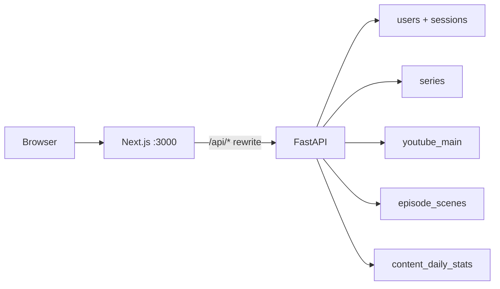
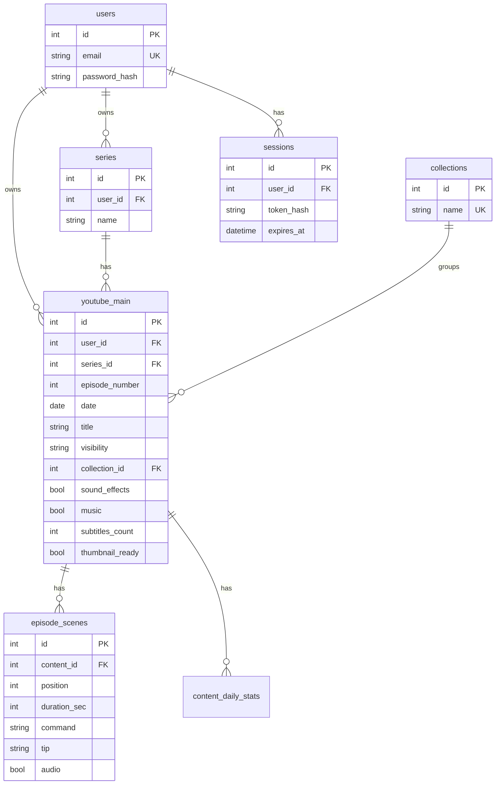

# Auth, dashboard, Lab, emulator, Library

The app today is a single unauthenticated page: dense analytics + a modal to create one command/tip script. There are **no users, no scenes, no extra routes**. This work turns it into a small authenticated studio with five surfaces.

**Schema source of truth:** [YouTube Main CSV](/home/unique/.cursor/projects/home-unique-Documents-projects-youtube-youtube-master/attachments/8b433e3d-9f57-4aba-bbe1-d3e7e398b948/YouTube_Master_Content_Managment_-_YouTube_Main___.csv) (exported from `youTube-master-content-managment-v001.xlsx`). That sheet is a denormalized episode log; we normalize it into related tables below. Only this one sheet was attached — extra workbook tabs (if any) are not in scope until provided.



## Schema from YouTube Main

Spreadsheet columns (verbatim): `Episode`, `Data` (date), `Title`, `Status`, `Collection`, `Sound Effects`, `Music`, `Subtitles`, `Tumbnaill`.

Example rows: `NETCAT Mastery — From Zero to Security Researcher #6` / `Netcat -n Flag = Faster Scans(Skip DNS) #6` / `Public` / `#N/A` / `TRUE` / `FALSE` / `0` / `TRUE`. Status in the sheet is **YouTube visibility** (`Public` | `Private`), not the old Draft → Published pipeline. Collection is unused (`#N/A`) on every row. Date can be empty. The same series+number can appear twice when a video flips Private → Public — **one row**, visibility updates, not duplicates.

### Normalized tables



**`series`** — parsed from the Episode cell. `"Logic in Motion #14"` → name `Logic in Motion`, number `14`. `"NETCAT Mastery — From Zero to Security Researcher #21"` → name `NETCAT Mastery — From Zero to Security Researcher`, number `21`. Unique `(user_id, name)`. Display string stays `"{name} #{n}"`.

**`youtube_main`** (replaces today’s `youtube_content` shape for product fields; keep existing table name `youtube_content` in SQL to avoid a painful rename, or migrate to `youtube_main` — **prefer rename to `youtube_main`** to match the sheet, with a one-shot Alembic-free `create_all` since local SQLite is disposable).

- Episode → `series_id` + `episode_number` (unique per user `(series_id, episode_number)`)
- Data → `date` (nullable)
- Title → `title`
- Status → `visibility`: `Public` | `Private` only
- Collection → `collection_id` (nullable; `#N/A` → null)
- Sound Effects → `sound_effects` boolean
- Music → `music` boolean (split from today’s combined `sound_music` string)
- Subtitles → `subtitles_count` integer (sheet uses `0`)
- Tumbnaill → `thumbnail_ready` boolean (not a URL)

**Keep on the same row (not in the sheet, still needed for the app):** `render_status`, `render_progress`, `render_error`, `video_path`, `created_at`. Drop old `status` (Draft/Scripting/…) as the primary field. Drop JSON `script` after scenes exist (derive scene 0 for renderer during the cutover).

**`collections`** — lookup (`Linux Basics`, `Network Hacking`, … plus user-empty). Optional FK.

**`episode_scenes`** — Lab/emulator (not in the sheet). `content_id` → `youtube_main`. Unique `(content_id, position)`. `duration_sec` summed onto the episode for display.

**`content_daily_stats`** — unchanged, FK to main row. Analytics KPIs stay.

**`users` / `sessions`** — auth; every `series` and `youtube_main` row is owner-scoped.

Seed: tests insert a user + a few Main rows matching sheet semantics (NETCAT / Logic in Motion / Nmap). Do **not** auto-seed 26 fake analytics episodes for every new register.

Frontend types in [`src/lib/types.ts`](src/lib/types.ts) and Pydantic in [`backend/app/schemas/content.py`](backend/app/schemas/content.py) follow these names (`visibility`, `soundEffects`, `music`, `subtitlesCount`, `thumbnailReady`, `episodeNumber`, `seriesName`).

## 1. Auth — email + password, bcrypt

**Accounts:** open register + login. All content is **per user**.

Backend ([`backend/app/db/models.py`](backend/app/db/models.py), new modules under `backend/app/`):

- Tables `users` (`email` unique, `password_hash`) and `sessions` (`token_hash`, `expires_at`, `user_id`).
- Hash with **bcrypt** (`bcrypt` package). Never store or log plaintext.
- Cookie `ytcm_session`: httpOnly, `SameSite=Lax`, `Path=/`, random token hashed at rest. Settings: `YTCM_SESSION_SECRET`, `YTCM_SESSION_TTL_DAYS` (default 14).
- Routes: `POST /api/auth/register`, `POST /api/auth/login`, `POST /api/auth/logout`, `GET /api/auth/me`.
- `get_current_user` FastAPI dep: 401 on missing/expired cookie. Apply to dashboard, content, renders, scenes. Leave `/api/health` public.
- CORS: `allow_credentials=True` (rewrites stay same-origin in the browser).
- Filter every list/get/patch/delete/render by owner. Episode numbers unique **per series per user**.
- Tests create a user, then seed that user’s Main rows.

Frontend:

- Public [`src/app/login/page.tsx`](src/app/login/page.tsx) and [`src/app/register/page.tsx`](src/app/register/page.tsx) — email + password only.
- Authenticated shell (`src/app/(studio)/layout.tsx`): nav (Home, Lab, Emulator, Library), theme, logout.
- SSR fetches ([`src/lib/server-api.ts`](src/lib/server-api.ts)) forward `Cookie`. Unauthenticated home redirects to `/login`.
- `credentials: "include"` on client `fetch`.

Tests: register/login/me/logout, duplicate email 400, wrong password 401, protected routes 401, user A cannot read user B’s episode.

## 2. Home dashboard — cards only

Replace the current wall of charts/table on [`src/app/page.tsx`](src/app/page.tsx) with a **minimal hub**.

Cards (reuse KPI styling from [`src/components/dashboard/kpi-cards.tsx`](src/components/dashboard/kpi-cards.tsx)):

- Channel: views / watch time / subs (existing `/api/dashboard` KPIs, default last 90d).
- Visibility: **Public** vs **Private** counts (from the sheet’s Status).
- Thumbnail / sound / music readiness counts (optional small cards).
- **Lab**, **Emulator**, **Library** as destination cards.
- Last 3 Main rows as compact lines, not the full table.

Move filters, charts, and the master table off Home into Library. Keep live render badge in the studio header.

## 3. First-class scenes + APIs

New table `episode_scenes` as in the ERD.

Endpoints (owner-scoped):

- `GET/POST /api/content/:id/scenes`
- `PATCH/DELETE /api/content/:id/scenes/:sceneId`
- `PUT /api/content/:id/scenes/reorder` with ordered ids
- `GET/POST /api/series` for Lab series picker
- Extend create/update of Main rows to spreadsheet fields
- Dashboard rows include `scenes[]` and `durationSec` = sum of scene durations

Create from Lab: Main metadata + initial scene list in one `POST /api/content`.

## 4. Unique Episode Creation Lab

Routes: `/lab` (new) and `/lab/[id]` (edit).

**Layout:** three columns, not a modal.

- **Left — scene stack:** numbered beat cards, drag reorder, add/duplicate/delete. Keyboard `j`/`k` to move, `Enter` to focus command.
- **Center — 9:16 stage:** the same light preview as the emulator, live as you type (no FFmpeg).
- **Right — YouTube Main meta:** series (select or type new), episode `#`, title, date, visibility Public/Private, collection (optional), Sound Effects, Music, subtitles count, thumbnail ready, “Queue FFmpeg render”.

Autosave (debounced PATCH) on edit; create on first save. “Open in emulator” links to `/emulator/[id]`.

Retire [`AddEpisodeDialog`](src/components/dashboard/add-episode-dialog.tsx) as the primary create path.

## 5. Episode light emulator (own route)

`/emulator` (picker, grouped by series) and `/emulator/[id]` (live env).

Client-only playback of scenes in a **phone bezel + fake Shorts chrome**. Play / pause / scrub; playhead drives which scene’s command+tip is on screen. Overlay uses Main `title` and series display name. No FFmpeg required.

**Renderer:** concat one FFmpeg clip per scene (command+tip cards, per-scene duration) → one MP4. Tests: multi-scene arg builder + existing FakeRenderer.

## 6. Library — the spec place for Main, scenes, meta

`/library` with tabs matching the workbook idea:

- **YouTube Main:** table with spreadsheet columns (Episode display, Date, Title, Status Public/Private, Collection, Sound FX, Music, Subtitles, Thumbnail) plus render/preview/delete and links to Lab/Emulator. Charts live here, not on Home. Filter by series, visibility, date.
- **Scenes:** flat list (series #, position, command, duration) → jump to Lab.
- **Meta:** series list, collections, visibility counts. Constants in [`backend/app/core/constants.py`](backend/app/core/constants.py) for visibility enums; series/collections are real tables.

## Frontend routing sketch

```
src/app/login/page.tsx
src/app/register/page.tsx
src/app/(studio)/layout.tsx
src/app/(studio)/page.tsx
src/app/(studio)/lab/page.tsx
src/app/(studio)/lab/[id]/page.tsx
src/app/(studio)/emulator/page.tsx
src/app/(studio)/emulator/[id]/page.tsx
src/app/(studio)/library/page.tsx
```

Shared UI: `StudioNav` from the current dashboard header; split [`dashboard.tsx`](src/components/dashboard/dashboard.tsx) so Home stays thin and Library reuses charts / table / `VideoPreviewDialog` with the new columns.

## Docs and config

- [`architechture.md`](architechture.md) / [`README.md`](README.md): auth, `youtube_main` fields from the sheet, `series`, `episode_scenes`.
- Restore/update [`backend/.env.example`](backend/.env.example) with `YTCM_SESSION_SECRET`.
- Add `bcrypt` to [`backend/requirements.txt`](backend/requirements.txt).
- Update [`src/lib/constants.ts`](src/lib/constants.ts): `STATUSES` → `Public` | `Private`; split sound vs music.

## Verification

- pytest: auth, isolation, unique `(series, episode_number)` per user, visibility filter, scene CRUD, 401s.
- vitest: types/constants; keep existing helpers green where they still apply.
- Browser: register → empty Home → Lab create a NETCAT-style row (Private, sound FX on, music off, thumbnail off) with 2 scenes → emulator play → flip Public in Library → logout/login. Mobile viewport on Lab.
